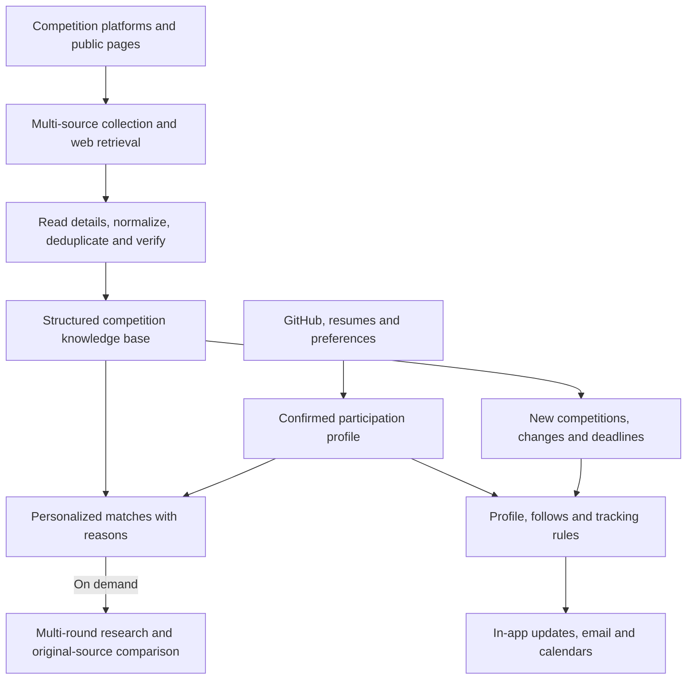

<p align="center">
  <a href="https://inkpaw.windup.xin">
    <picture>
      <source media="(prefers-color-scheme: dark)" srcset="docs/assets/readme/inkpaw-logo-dark.png">
      
    </picture>
  </a>
</p>

<h3 align="center">Discover competitions matched to your interests and strengths.</h3>

<p align="center">
  <a href="https://github.com/hackathon-crew/contest-detective/releases/latest"></a>
  <a href="https://github.com/hackathon-crew/contest-detective/actions/workflows/backend.yml"></a>
  <a href="https://github.com/hackathon-crew/contest-detective/actions/workflows/frontend.yml"></a>
</p>

<p align="center">
  <strong><a href="https://inkpaw.windup.xin/account/profile">Build your profile ↗</a></strong>
  &nbsp; · &nbsp; <a href="https://inkpaw.windup.xin/contests">Browse competitions</a>
  &nbsp; · &nbsp; <a href="#deep-research-and-source-verification">Deep research</a>
  &nbsp; · &nbsp; <a href="#ongoing-watches-and-email-updates">Email updates</a>
  &nbsp; · &nbsp; <a href="README.md">简体中文</a>
  &nbsp; · &nbsp; <a href="https://github.com/hackathon-crew/contest-detective/issues/new/choose">Feedback</a>
</p>

**Inkpaw** (比赛侦探, Contest Detective) is a **personalized competition discovery and tracking tool** for students and developers. Connect your public GitHub profile, review the skills and interests extracted from your projects, and find competitions that fit your confirmed identity, availability, location, and participation preferences—with reasons for each recommendation.

Your participation profile carries through discovery, deep research, source verification, and ongoing watches and email updates. A structured competition knowledge base, multiple retrieval paths, and a scheduled update pipeline keep supplying the information behind those experiences.

<p align="center"><a href="https://inkpaw.windup.xin"></a></p>

<p align="center"><sub>Product screenshots were captured from live v0.1.27 on October 25, 2026. Competition data and subsequent interfaces continue to change.</sub></p>

## Three core capabilities

| Capability | What you can accomplish |
| :--- | :--- |
| **Personalized profile matching** | Sign in, connect GitHub, automatically extract skills and project interests, confirm your profile, and receive competitions with project-backed reasons. |
| **Deep research and verification** | Plan an investigation, run different queries across rounds, read original pages, compare sources, and obtain a report with evidence and completion status. |
| **Ongoing watches and email updates** | Discover new matches, track followed competitions and deadline milestones, and receive digests and reminders according to your settings. |

## From GitHub to competitions that fit

**Sign in → connect GitHub → extract a profile → review and confirm → match competitions → inspect the reasons.**

1. **Read your public projects.** Enter a GitHub username in your [profile](https://inkpaw.windup.xin/account/profile). Inkpaw reads public repository languages, topics, descriptions, and activity to build editable skills and interests. You can also import a PDF / DOCX / TXT résumé or add information manually.
2. **Add participation constraints.** Confirm your interests, identity, city, online or in-person preferences, availability windows, and maximum consecutive participation days. The profile is saved to your account and remains editable.
3. **Match using your background.** Enable “按我的情况挑” in the catalog. Matching considers known eligibility, time, and location constraints, then ranks by topic and skill overlap. Ended competitions and passed deadline milestones are excluded.
4. **Understand the recommendation.** When project topics match a competition, the reason can link to the relevant GitHub repositories. Skill overlap and known scheduling compatibility are explained. Results without topic or skill overlap explicitly say that they only meet your filters.

Personalization is grounded in your confirmed profile and traceable project information. You can edit the inputs and inspect why a competition appears.

<p align="center"></p>

List and calendar views, city and format filters, deadline ranges, and follows help you compare the candidates.

## Deep research and source verification

For a promising competition, ask the detective whether you meet its entry rules, whether a deadline has changed, or where the prize and submission requirements were published. **Deep research plans the investigation, executes different Yuanbao queries across multiple rounds, reads original pages, and cross-checks each claim.**

- **Visible research:** inspect the plan, actual queries, tool steps, and pages read in the research panel.
- **Original evidence:** distinguish supported, contradicted, conflicting, and unverified claims. Search snippets and historical cards are leads; conclusions cite original pages read in the current run.
- **Independent corroboration:** mirrors and reposts with unknown provenance do not count again as independent sources. Insufficiently supported targets remain incomplete.
- **Portable reports:** export Markdown or JSON to review participation plans with teammates.

You can also recognize competition screenshots locally in the browser, edit and confirm the text, select individual claims, and submit them for investigation. Recognition remains a lead; verification continues to seek public original sources.

<p align="center"></p>

Registration, submission, start, and end dates are recorded separately. Day-only evidence keeps its precision. Official sources, reposts, conflicts, and missing-information states remain distinct so you can see what is supported and what needs further checking.

<details>
<summary>Four investigation modes and evidence boundaries</summary>

- **Standard recommendations:** use the catalog and compatible available search providers. This does not mean Yuanbao performed live verification in the current run.
- **Catalog only:** use existing competition and profile tools, without registering page-reading, search, or write-back tools.
- **Live verification:** requires configured Yuanbao search and actual execution, with no fallback to another provider. The model plans steps and connects each claim to original pages read in the current run, clickable sources, and actual search traces. Unexecuted steps, failures, and insufficient evidence remain explicitly incomplete.
- **Deep investigation:** builds on live verification with distinct queries across rounds, coverage of the investigation plan, and claim-by-claim comparisons of original sources. Mirrors and reposts with unknown provenance do not count as independent corroboration. A search-count threshold alone does not establish completion.

Reports distinguish supported, contradicted, conflicting, and unverified claims from source grades such as official or reposted, and export the same content as Markdown or JSON. Search snippets and historical catalog cards are leads rather than original evidence from the current run. Page reads retain public-address, DNS, and redirect safety checks. Reports exclude account keys, user profiles, and sensitive links.

Investigation covers public competition information, excluding political or current-affairs claims and messages about individuals. Text recognized from screenshots must be confirmed by the user before submission as claims to investigate; recognition is not factual evidence. An event allowing individual participation is an ordinary eligibility rule and does not fall under personal messages.

</details>

## Ongoing watches and email updates

Save your preferences in [Competition email](https://inkpaw.windup.xin/account/push) to keep discovering relevant opportunities and following competitions you already care about.

| What you follow | What you receive |
| :--- | :--- |
| **New profile matches** | Newly collected competitions selected using your saved profile, with recommendation reasons and detail links. |
| **Saved tracking conditions** | Natural-language preferences converted into checkable filters for topics, locations, formats, or deadline ranges. |
| **Changes to followed competitions** | Notifications when deadlines, locations, prizes, or source-verification status change. |
| **Approaching deadlines** | Advance reminders according to your settings, keeping registration and submission deadlines distinct. |

Choose daily, weekly, or newly collected digest modes; configure Beijing time and reminder lead times; preview the next email, send a test, and inspect delivery records. Newly collected digests still allow at most one per day. Competition changes and deadline reminders are scheduled separately.

Follows sync with your account and support a personal calendar feed. In-app watches also keep private records of before-and-after values, sources, and occurrence times. In-app read status is separate from email processing.

Email sending requires the operator to configure and enable Resend, plus the user's own email preferences. Automatic organizer-page checks have a separate watch setting; their activation and cadence are explained below.

<details>
<summary>In-app watches, automatic checks, and check status</summary>

After signing in, enable watching for individual followed competitions under Account → Follows. Private updates preserve the before-and-after field values, sources, and timestamps as they were when the change occurred. Historical records without a saved snapshot do not produce invented changes. Updates are visible only to their account owner; read status is independent of email processing. Pausing stops new updates, resuming starts from the current version, and unfollowing removes the watch subscription.

The page distinguishes a paused subscription, globally paused automatic checks, actual last-check results, and an estimated next check. `DETECTIVE_WATCH_ENABLED` defaults to `false`: it does not start website checks or re-enable source synchronization or email. When an administrator explicitly enables it, checks rotate through never-checked and least-recently-checked items, with a default interval of 1,440 minutes per item and at most 30 items per batch. The estimate is the earliest eligible check time, not a promise that every followed competition is checked daily. Failed fetches preserve the last successful time; competitions sharing an official page fetch it only once per batch. Page access and model calls retain the existing budget and source-safety constraints.

</details>

## Knowledge base, web retrieval, and the daily pipeline

Inkpaw combines a **structured competition knowledge base with web-enhanced retrieval**. The knowledge base preserves reusable competitions, date precision, and field sources. Web retrieval discovers opportunities, reads organizer announcements, and obtains original evidence for the current investigation. Profiles guide matching, while catalog additions and changes continue into personal notifications.



| Technical mechanism | Product benefit |
| :--- | :--- |
| **Multiple discovery sources** | Structured adapters for Devpost, HackerTrip, and WaytoAGI combine with public pages, WeChat search, and other source adapters to address gaps in any one source. |
| **Multiple retrieval paths and deduplication** | Standard search can combine Yuanbao and Tavily and deduplicate the merged results. Live and deep verification require actual Yuanbao execution records and continue through different queries, rounds, and original pages. |
| **Scheduled update pipeline** | The backend supports a daily Beijing-time schedule or intervals for collection, detail enrichment, normalization, deduplication, verification, and persistence. Execution and failures are recorded; one failed competition does not discard other successful records. |
| **Field evidence and deterministic processing** | Models interpret requests and extract content; code handles dates, eligibility and availability filters, ranking, deduplication, and report completion rules. Conclusions retain inspectable sources. |
| **Change events and personal delivery** | Persisted additions and changes connect to profiles, tracking conditions, and follows, turning refreshed data into personal digests and reminders. |

Implementation: [GitHub profiles](backend/src/contest_detective/server/user/github.py) · [Matching](backend/src/contest_detective/server/user/matching.py) · [Deep verification](backend/src/contest_detective/server/agent/verification.py) · [Update pipeline](backend/src/contest_detective/server/research_pipeline/pipeline/execute.py) · [Daily scheduling](backend/src/contest_detective/server/research_pipeline/scheduler.py) · [Email delivery](backend/src/contest_detective/server/notifications/service.py).

## Get started

1. [Sign in and build your profile](https://inkpaw.windup.xin/account/profile), connect GitHub, and confirm skills, interests, and participation preferences.
2. Enable “按我的情况挑” in the [catalog](https://inkpaw.windup.xin/contests), inspect recommendation reasons, and use the [detective](https://inkpaw.windup.xin/detective) to investigate specific questions.
3. Follow candidates, save your frequency and tracking conditions under [email preferences](https://inkpaw.windup.xin/account/push), and optionally subscribe to your personal calendar.

The public catalog and anonymous MCP are available directly. Accounts save profiles, follows, tracking conditions, and settings. The web interface is currently primarily Chinese.

## Connect via MCP

Endpoint: **`https://inkpaw.windup.xin/mcp`**. Transport: **Streamable HTTP**. The website and MCP read the same catalog, including source links, verification levels, and date precision.

<p align="center"></p>

### Query public competitions

For Claude Code:

```bash
claude mcp add --transport http inkpaw https://inkpaw.windup.xin/mcp
```

For Cursor, add this to `.cursor/mcp.json` or `~/.cursor/mcp.json`:

```json
{
  "mcpServers": {
    "inkpaw": {
      "url": "https://inkpaw.windup.xin/mcp"
    }
  }
}
```

Then ask your client: “Use Inkpaw to find online competitions with upcoming deadlines. Include registration links and the sources behind each date.”

### Read your profile and follows

Generate a personal token under [Search and keys](https://inkpaw.windup.xin/account/keys), then add an `Authorization` header:

```bash
claude mcp add --transport http inkpaw https://inkpaw.windup.xin/mcp \
  --header "Authorization: Bearer YOUR_PERSONAL_TOKEN"
```

For Cursor, use this personal configuration:

```json
{
  "mcpServers": {
    "inkpaw": {
      "url": "https://inkpaw.windup.xin/mcp",
      "headers": {
        "Authorization": "Bearer YOUR_PERSONAL_TOKEN"
      }
    }
  }
}
```

The two Claude Code commands are alternative anonymous and personal configurations; choose one. A complete token is shown only when generated, and rotating it immediately invalidates the previous token. Keep it in your local client configuration.

| Tool | Access | Input and output |
| :--- | :--- | :--- |
| `search_contests` | Anonymous / personal | Optional `keyword`, `status`, `mode`, `date_from`, `date_to`, `ids`, `sort`, `page`, `page_size`; returns paginated results. |
| `get_contest` | Anonymous / personal | Required `id`; returns complete competition details and sources. |
| `match_contests` | Anonymous / personal | Required `profile`; returns competitions, match reasons, and ranking scores. |
| `get_my_profile` | Personal token | No arguments; returns the token owner's saved profile. |
| `get_my_follows` | Personal token | No arguments; returns the owner's followed competitions and reminder settings. |
| `get_my_tracking` | Personal token | No arguments; returns the owner's tracking conditions. |

Example public query: `{"keyword":"Python","mode":"online","page_size":5}`. Example explicit profile match: `{"profile":{"skills":["Python"],"preferred_modes":["online"]}}`.

MCP tools read existing business data. They do not search the web, call a model, or save the supplied matching profile. Personal-token authentication updates the token's last-used time. The public endpoint allows 60 requests per minute per IP, a burst of 20, and up to 4 concurrent connections, with a 64 KiB request limit. Rate-limit violations return HTTP 429.

<details>
<summary>Local stdio MCP: read your own SQLite database</summary>

Install dependencies and run migrations using the local setup below, then start:

```bash
uv run --directory backend contest-detective-mcp
```

By default it reads `contest_detective.db` in the backend working directory. Set `DETECTIVE_DB_URL` to select another existing database. The SQLite connection uses file read-only mode; startup does not create a database or run migrations. Logs go to standard error, leaving standard input and output for MCP. Local stdio exposes the three public tools and does not read account data.

```json
{
  "mcpServers": {
    "inkpaw-local": {
      "command": "uv",
      "args": ["run", "--directory", "/absolute/path/to/contest-detective/backend", "contest-detective-mcp"],
      "env": {
        "DETECTIVE_DB_URL": "sqlite:////absolute/path/to/contest_detective.db"
      }
    }
  }
}
```

Replace the example paths with absolute paths to your checkout and database.

</details>

## Run locally

Requires **Python 3.12+, uv, Node.js 24, and npm**. The backend uses FastAPI, SQLAlchemy, Alembic, and SQLite; the frontend uses React, TypeScript, and Vite.

```bash
git clone https://github.com/hackathon-crew/contest-detective.git
cd contest-detective
cp .env.example .env
uv sync --locked --directory backend
uv run --directory backend alembic upgrade head
uv run --directory backend contest-detective
```

In another terminal:

```bash
cd contest-detective/frontend
npm ci
npm run dev
```

Open the address printed by Vite, normally `http://localhost:5173`. The development proxy forwards `/api` to `http://127.0.0.1:8000`. Backend health is at `http://127.0.0.1:8000/health`; interactive API documentation is at `http://127.0.0.1:8000/docs`.

**A fresh installation has an empty database.** Model calls, scheduled collection, and email are disabled by default. Starting the application does not import the production catalog. Once source settings are ready, explicitly run `uv run --directory backend contest-detective-sync`, or import reviewed public evidence with the offline tool below.

| Capability | Configuration |
| :--- | :--- |
| Detective and résumé understanding | Set `DETECTIVE_LLM_ENABLED=true`, `DETECTIVE_LLM_API_KEY`, `DETECTIVE_LLM_BASE_URL`, and `DETECTIVE_LLM_MODEL`. Adjust `DETECTIVE_LLM_DEEPSEEK_OPTIONS` when changing providers. |
| Web search | Configure Yuanbao's `DETECTIVE_YUANBAO_SECRET_ID` / `DETECTIVE_YUANBAO_SECRET_KEY`, or `DETECTIVE_TAVILY_API_KEY`. |
| Scheduled collection | Set `DETECTIVE_SYNC_DAILY_AT` or `DETECTIVE_SYNC_INTERVAL_MINUTES`. Source extraction also depends on model configuration. |
| Automatic watching | `DETECTIVE_WATCH_ENABLED` defaults to off. When enabled, `DETECTIVE_WATCH_INTERVAL_MINUTES` and `DETECTIVE_WATCH_BATCH_SIZE` control the interval and batch size. |
| Personal provider keys | Generate and retain a separate `DETECTIVE_ACCOUNT_ENCRYPTION_KEY` to encrypt account-owned model and search keys. |
| Email and subscription URLs | Set `DETECTIVE_PUBLIC_BASE_URL`. Sending also needs Resend credentials, a sender address, and `DETECTIVE_MAIL_ENABLED=true`. |

See [`.env.example`](.env.example) for all settings. Model and search calls use the configured providers' allowances. Local budget modes and production setup are covered in the [deployment guide](deploy/README.md); frontend proxies and generated API types are covered in the [frontend guide](frontend/README.md).

<details>
<summary>Offline refresh: import reviewed public evidence</summary>

`contest-detective-refresh` imports reviewed `contest-refresh-v1` manifests. It does not access the network, read `.env`, start schedulers, call a model, or fetch and interpret pages. Each entry contains competition identity, the SHA-256 of the saved text, its representation and completeness, excerpts, and sources. Cited summaries are optional. Search snippets and partial excerpts must be marked `partial`; they cannot establish that a rule is absent from the full page.

Migrate an explicitly selected local SQLite database, then run the default read-only dry run:

```bash
uv run --directory backend contest-detective-refresh \
  --database /absolute/path/to/contest.db \
  --manifest /absolute/path/to/reviewed-public-evidence.json \
  --output-directory /absolute/path/to/refresh-reports
```

Review the report before adding `--apply`. Failures are isolated per competition. Omitted historical fields and text remain intact, and applying an identical manifest again does not duplicate writes. `created` and `updated` count distinct competitions; `applied_entries` counts manifest entries. Source-discovery counts and pagination stop reasons are reported separately. Failed entries remain in the report and can be retried after review with a new manifest version. Changed content requires a new `manifest_id`; different editions or incompatible dates are rejected for automatic merging.

Before writing, the tool creates a SQLite backup and a rollback record containing only changes to public competition tables. The backup can contain other database records and belongs in protected local storage. Rollback reverses this run's competition changes without overwriting subsequent account data. It refuses when affected records have since changed or private records reference a newly created competition:

```bash
uv run --directory backend contest-detective-refresh \
  --database /absolute/path/to/contest.db \
  --rollback /absolute/path/to/refresh-reports/refresh-run/changes.json \
  --output-directory /absolute/path/to/refresh-reports --apply
```

Correcting an old mapping requires its old source, value, excerpt, reason, replacement evidence, and an expected public-data fingerprint. Partial fetches cannot overwrite history, and imports cannot silently change a historical source's official status. The command does not deploy or connect to production; production imports use a separately reviewed operational channel. Ordinary page GETs and deployment migrations do not import manifests.

</details>

## Data and behavior

- **Public sources.** Collection and search cover Devpost, HackerTrip, WaytoAGI, ETHGlobal, Huodongxing, and organizers' public websites and WeChat posts. Coverage varies by source; ask the detective when the catalog does not contain what you need.
- **Source text.** New source documents expose necessary excerpts and links by default; historical full text is retained, and details load on demand. Competition posters and third-party brands in screenshots belong to their respective owners.
- **Personal information.** Confirmed profiles and preferences are saved after sign-in. Résumé import uses the configured model service, so provide the information needed for competition matching. GitHub profiles use public information.
- **Conversations.** History stays in the current browser and is isolated by signed-in identity. You can refresh and continue; history currently does not sync across devices.
- **Credentials.** Personal model and search keys are stored encrypted and returned masked. Personal MCP tokens are stored as hashes. Account settings support data export and confirmed account deletion.

## macOS companion

The repository also includes a native [Inkpaw Companion](plugins/inkpaw-macos/README.md): a desktop octopus, milestone countdowns, submission checklists, questions over local rule documents, read-only Git activity, and system reminders.

It is a separate **macOS 15+ development build**, requiring a Swift 6 toolchain, and is not signed, notarized, or formally released. See the [companion guide](plugins/inkpaw-macos/README.md) for build instructions and boundaries, and the [macOS workflow](https://github.com/hackathon-crew/contest-detective/actions/workflows/inkpaw-macos.yml) for native verification results.

## Contribute

Found a wrong date, missing source, or product issue? [Open an issue](https://github.com/hackathon-crew/contest-detective/issues/new/choose) with the competition link and original evidence. Contributions follow **Issue → branch → PR**; see [CONTRIBUTING.md](CONTRIBUTING.md).

[Releases](https://github.com/hackathon-crew/contest-detective/releases) · [Milestones](https://github.com/hackathon-crew/contest-detective/milestones) · [Deployment](deploy/README.md) · [Frontend development](frontend/README.md) · [hackathon-crew](https://github.com/hackathon-crew)

The repository does not currently declare an open-source license.
