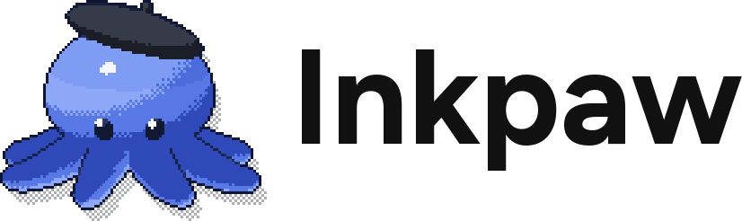
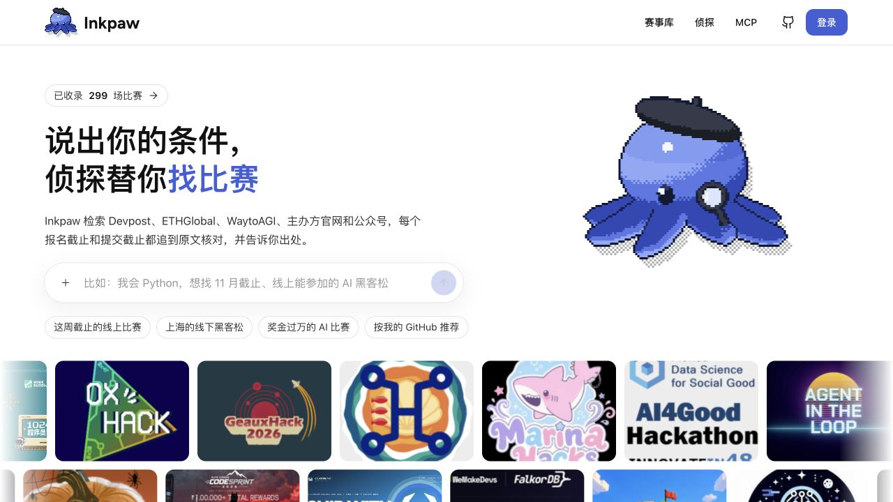
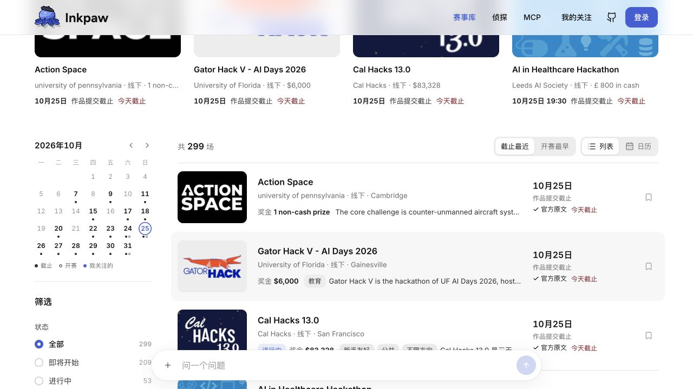
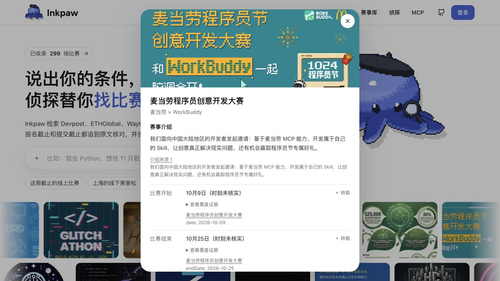
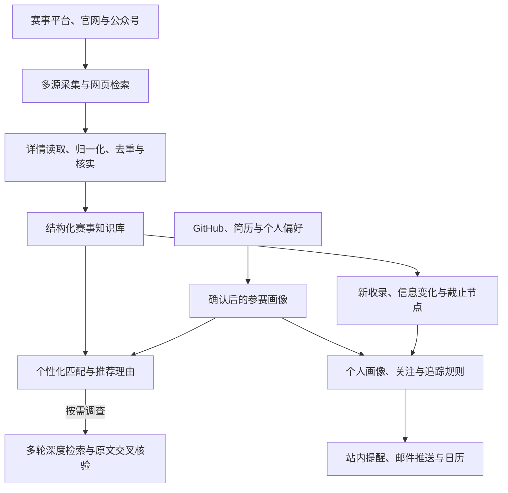
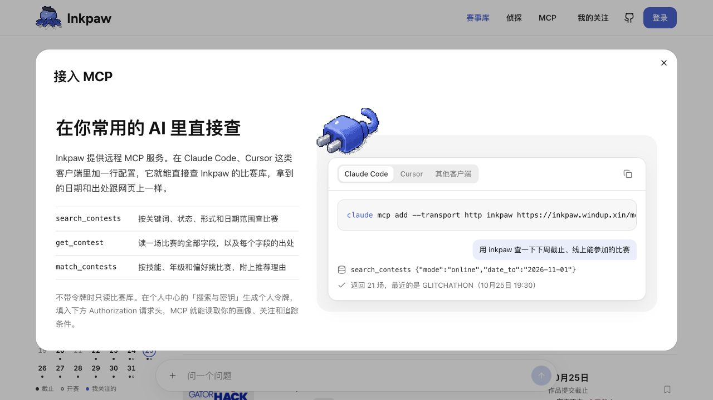

<p align="center">
  <a href="https://inkpaw.windup.xin">
    <picture>
      <source media="(prefers-color-scheme: dark)" srcset="docs/assets/readme/inkpaw-logo-dark.png">
      
    </picture>
  </a>
</p>

<h3 align="center">根据你的兴趣与优势，寻找适合你的比赛。</h3>

<p align="center">
  <a href="https://github.com/hackathon-crew/contest-detective/releases/latest"></a>
  <a href="https://github.com/hackathon-crew/contest-detective/actions/workflows/backend.yml"></a>
  <a href="https://github.com/hackathon-crew/contest-detective/actions/workflows/frontend.yml"></a>
</p>

<p align="center">
  <strong><a href="https://inkpaw.windup.xin/">在线体验：https://inkpaw.windup.xin/ ↗</a></strong>
  &nbsp; · &nbsp; <a href="https://inkpaw.windup.xin/contests">浏览赛事库</a>
  &nbsp; · &nbsp; <a href="#深度检索与原文核验">深度检索</a>
  &nbsp; · &nbsp; <a href="#持续盯梢与邮件推送">盯梢推送</a>
  &nbsp; · &nbsp; <a href="README.en.md">English</a>
  &nbsp; · &nbsp; <a href="https://github.com/hackathon-crew/contest-detective/issues/new/choose">反馈问题</a>
</p>

**Inkpaw**（比赛侦探）是一款面向大学生与开发者的**个性化比赛推荐与持续追踪工具**。关联 GitHub，自动整理公开项目中的技术栈与兴趣方向，结合你确认的身份、时间、地点和参赛偏好，寻找合适的比赛，并说明为什么推荐给你。

从建立画像、寻找机会，到深度检索、核对原文，再到关注后的变化提醒与邮件推送，Inkpaw 把个人参赛背景贯穿整个过程。底层的结构化赛事知识库、多源检索和每日更新 Pipeline，为推荐与追踪持续提供数据。

## 视频演示

[**我把 GitHub 丢给 AI，让它帮我挑黑客松 · 哔哩哔哩在线观看 ↗**](https://www.bilibili.com/video/BV1MgHG66EDA/)

51 秒演示：GitHub 画像推荐、深度检索与邮件盯梢。

<p align="center"><a href="https://inkpaw.windup.xin"></a></p>

<p align="center"><sub>产品截图摄于 2026 年 10 月 25 日的线上版本 v0.1.27；赛事数据与后续界面会继续更新。</sub></p>

## 三项核心能力

| 核心能力 | 你可以完成的事 |
| :--- | :--- |
| **个性化画像推荐** | 登录账号，关联 GitHub，自动提取技术栈、项目方向与兴趣；确认画像后，结合参赛条件匹配比赛，查看有项目依据的推荐理由。 |
| **深度检索与核验** | 围绕目标赛事或待查说法制定调查计划，分轮检索、读取原文、交叉比对来源，获得带证据和完成状态的报告。 |
| **持续盯梢与邮件推送** | 按画像和追踪条件接收新机会，关注比赛的截止节点、地点、奖金和核实状态变化，按个人设置接收摘要与提醒。 |

## 从 GitHub 到适合你的比赛

**登录账号 → 关联 GitHub → 自动提取画像 → 编辑确认 → 匹配比赛 → 查看推荐理由。**

1. **读取你的公开项目。** 在[个人画像](https://inkpaw.windup.xin/account/profile)填写 GitHub 用户名。Inkpaw 读取公开仓库的语言、topics、项目说明与活跃记录，生成可编辑的技能与兴趣画像；也可导入 PDF / DOCX / TXT 简历或手动补充。
2. **加上真实参赛条件。** 确认兴趣方向、身份、所在城市、线上或线下偏好、可投入日期与连续参赛时长。画像随账号保存，之后可以继续修改。
3. **按你的情况匹配。** 在赛事库选择「按我的情况挑」。系统结合已知报名资格、时间与地点条件筛选，再按兴趣和技能重合排序；已结束或已过截止节点的比赛会被排除。
4. **看懂推荐理由。** 当项目 topics 与赛道相关时，理由可引用对应 GitHub 仓库；技能匹配和已知时间安排也会说明。没有找到技能或主题重合时，结果会直接说明只符合筛选条件。

个性化的依据来自你确认的画像和可追溯的项目资料。你能修改这些依据，也能检查一场比赛为什么出现在推荐中。

<p align="center"></p>

赛事库同时提供列表、日历、城市、形式、截止时间和关注筛选，方便把候选比赛放在一起比较。

## 深度检索与原文核验

找到感兴趣的比赛后，可以继续问侦探：报名资格是否符合、截止日期有没有变化、奖金与提交要求分别来自哪里。**深度调查会拆分问题，执行不同查询的多轮元宝搜索，再读取原文、逐项交叉核对。**

- **调查过程可见。** 计划、实际查询、工具步骤和读取的页面保留在研究面板中。
- **结论有原文支持。** 区分证据支持、证据反驳、来源冲突和尚未核实；搜索摘要与历史卡片作为线索，结论引用本轮读取的原文。
- **交叉核验检查来源独立性。** 同文镜像和出处不明的转载不会重复算作独立证据；证据不足的目标保留未完成状态。
- **报告可以带走。** 支持 Markdown / JSON 导出，方便与队友共同确认参赛安排。

还可以在浏览器本地识别赛事截图，编辑并确认识别文字，分条选择待核实说法，再提交调查。识别结果本身保留为线索，后续核验继续查找公开原文。

<p align="center"></p>

报名截止、作品提交截止、开赛和结束时间分别记录。只核实到日期时保留日期精度；官方原文、转载、来源冲突以及缺失原因分别展示，便于判断哪些信息已经有依据、哪些还需要继续确认。

<details>
<summary>四种调查方式与证据边界</summary>

- **普通推荐**：保留赛事库与可用搜索服务的兼容工作流，不表示本轮已由元宝实时核验。
- **比赛库**：只使用已有赛事和画像工具，不注册网页读取、搜索或写回工具。
- **实时核验**：必须配置并实际执行元宝搜索，不会退回其他搜索服务。模型先拆步骤，再把每条待查说法关联到本轮已读取原文、可点击来源和实际搜索轨迹；未执行、失败或证据不足会明确标为未完成。
- **深度调查**：在实时核验基础上，分轮执行不同查询、覆盖调查计划并逐条交叉比对原始来源。同文镜像和无法确认出处的转载不计作独立交叉证据；只有搜索次数达到要求不会自动变成“已完成”。

调查报告区分“证据支持 / 证据反驳 / 来源冲突 / 尚未核实”和“官方 / 转载”等来源等级，可导出相同内容的 Markdown 或 JSON。搜索摘要和历史赛事卡片仅作为线索，不冒充本轮原文证据。页面读取沿用公开地址、DNS 和重定向安全检查，报告不包含账号密钥、用户画像或敏感链接。

仅核验公开赛事信息，不调查时政或涉及个人的消息。截图识别结果须经用户确认后作为待查说法提交，不是事实证据。普通参赛资格中的“个人参赛”不属于个人消息。

</details>

## 持续盯梢与邮件推送

在[比赛推送](https://inkpaw.windup.xin/account/push)保存偏好后，Inkpaw 可以持续为你筛选新机会，并追踪已经关注的比赛。

| 盯什么 | 收到什么 |
| :--- | :--- |
| **适合你的新比赛** | 从新收录赛事中按已保存画像筛选，邮件附比赛信息、推荐理由和详情链接。 |
| **你保存的追踪条件** | 将自然语言条件转成可检查的筛选规则，持续关注指定方向、地点、形式或截止日期范围。 |
| **关注赛事的变动** | 截止时间、地点、奖金或来源核实状态变化时，生成相应提醒。 |
| **临近截止的节点** | 按个人设置提前提醒，区分报名截止与作品提交截止。 |

支持每日、每周和新收录触发的摘要模式，可设置北京时间、提醒提前天数，并预览下一封、发送测试邮件和查看投递记录。新收录触发的摘要仍按每天最多一封处理，赛事变动和截止提醒独立调度。

关注随账号同步，支持个人日历订阅。站内盯梢还提供带变化前后、来源和发生时间的私人记录；站内已读状态与邮件消费分别维护。

邮件发送由部署者配置 Resend 并启用，用户另行开启自己的推送设置。自动官网核对使用独立的盯梢开关；启用条件与检查节奏见下方说明。

<details>
<summary>站内盯梢、自动核对与检查状态</summary>

登录后在「个人中心 → 关注的比赛」为已关注赛事单独开启盯梢。站内变化保留发生时的前后字段、来源与时间；旧记录没有历史快照时不会补造变化。提醒只对当前账号可见，已读状态与邮件消费互不影响。暂停后不再产生新的提醒，恢复从当前版本开始；取消关注会移除盯梢订阅。

页面分别显示订阅暂停、全站自动检查暂停、真实最后检查结果与预计下次时间。`DETECTIVE_WATCH_ENABLED` 默认 `false`，不会自行启动官网核对，也不会恢复来源同步或邮件。管理员另行启用后，按从未检查/最久未检查顺序轮转，默认每项间隔 1440 分钟、每批最多 30 项；预计时间是最早可检查时间，不保证所有关注每天都被覆盖。抓取失败保留上次成功时间，同一批次共享官网只抓取一次。网页与模型配置仍使用现有预算和来源安全限制。

</details>

## 知识库、网页检索与每日更新 Pipeline

Inkpaw 将**结构化赛事知识库与网页增强检索**结合。知识库存储可重复查询的赛事、日期精度与字段出处；网页检索补充新机会、读取主办方公告，并为当前调查取得原文。个人画像参与匹配，比赛库的新增与变化继续进入个人通知流程。



| 技术机制 | 对产品体验的作用 |
| :--- | :--- |
| **多源发现** | 结构化接入 Devpost、HackerTrip、WaytoAGI，并通过公开网页、公众号和来源适配器发现更多赛事，减少单一来源的覆盖缺口。 |
| **多路检索与去重合并** | 普通搜索可组合元宝与 Tavily，合并并去重结果；实时与深度核验要求实际元宝执行记录，多查询、多轮次继续核对原文。 |
| **每日更新 Pipeline** | 后端可按北京时间每日固定时刻或间隔运行采集、详情补全、归一化、去重、核实与入库；保存执行状态及失败信息，单条赛事失败不会丢弃其他成功结果。 |
| **字段级证据与确定性处理** | 模型理解查询与抽取内容，代码执行日期比较、资格与时间筛选、匹配排序、去重及报告完成条件；每个结论保留可检查的来源。 |
| **变更事件与个人通知** | 入库后的新增和变化连接画像匹配、追踪条件与关注设置，让每日更新的数据继续产生个性化摘要和提醒。 |

实现入口：[GitHub 画像](backend/src/contest_detective/server/user/github.py) · [画像匹配](backend/src/contest_detective/server/user/matching.py) · [深度核验](backend/src/contest_detective/server/agent/verification.py) · [更新 Pipeline](backend/src/contest_detective/server/research_pipeline/pipeline/execute.py) · [每日调度](backend/src/contest_detective/server/research_pipeline/scheduler.py) · [邮件推送](backend/src/contest_detective/server/notifications/service.py)。

## 开始使用

1. [登录并建立画像](https://inkpaw.windup.xin/account/profile)，关联 GitHub，确认技能、兴趣和参赛偏好。
2. 在[赛事库](https://inkpaw.windup.xin/contests)开启「按我的情况挑」，查看推荐理由；有具体问题时进入[侦探](https://inkpaw.windup.xin/detective)继续调查。
3. 关注候选比赛，在[推送设置](https://inkpaw.windup.xin/account/push)保存频率与追踪条件，按需订阅个人日历。

浏览公共赛事库和匿名 MCP 可直接使用。账号用于保存画像、关注、追踪条件与个人设置；网页界面目前以中文为主。

## 接入 MCP

远程地址：**`https://inkpaw.windup.xin/mcp`**，传输方式为 **Streamable HTTP**。网页与 MCP 读取同一份赛事库，字段出处、核实等级和日期精度随结果一并返回。

<p align="center"></p>

### 直接查公共赛事

以 Claude Code 为例：

```bash
claude mcp add --transport http inkpaw https://inkpaw.windup.xin/mcp
```

Cursor 在 `.cursor/mcp.json` 或 `~/.cursor/mcp.json` 中配置：

```json
{
  "mcpServers": {
    "inkpaw": {
      "url": "https://inkpaw.windup.xin/mcp"
    }
  }
}
```

连接后，可以向客户端提问：「用 Inkpaw 查一下最近截止、线上能参加的比赛，把报名链接和日期出处一起列出来。」

### 读取自己的画像和关注

在个人中心的[搜索与密钥](https://inkpaw.windup.xin/account/keys)生成个人令牌，然后添加 `Authorization` 请求头：

```bash
claude mcp add --transport http inkpaw https://inkpaw.windup.xin/mcp \
  --header "Authorization: Bearer YOUR_PERSONAL_TOKEN"
```

Cursor 的个人配置如下：

```json
{
  "mcpServers": {
    "inkpaw": {
      "url": "https://inkpaw.windup.xin/mcp",
      "headers": {
        "Authorization": "Bearer YOUR_PERSONAL_TOKEN"
      }
    }
  }
}
```

上面的两条 Claude Code 命令是匿名与个人两种配置方式，选择一种即可。完整令牌只在生成时显示一次，轮换后旧令牌立即失效；请将令牌留在本机客户端配置中。

| 工具 | 可用范围 | 输入与结果 |
| :--- | :--- | :--- |
| `search_contests` | 匿名 / 个人 | 可传 `keyword`、`status`、`mode`、`date_from`、`date_to`、`ids`、`sort`、`page`、`page_size`；返回分页结果。 |
| `get_contest` | 匿名 / 个人 | 必填 `id`；返回一场比赛的完整详情与出处。 |
| `match_contests` | 匿名 / 个人 | 必填 `profile`；返回比赛、匹配理由和排序分数。 |
| `get_my_profile` | 个人令牌 | 无参数；返回令牌所属账号已保存的画像。 |
| `get_my_follows` | 个人令牌 | 无参数；返回本人关注的比赛及提醒开关。 |
| `get_my_tracking` | 个人令牌 | 无参数；返回本人的追踪条件。 |

例如，公共查询参数为 `{"keyword":"Python","mode":"online","page_size":5}`，显式画像匹配参数为 `{"profile":{"skills":["Python"],"preferred_modes":["online"]}}`。

MCP 工具只读取已有业务数据，不联网检索、不调用模型、不保存传入的画像。个人令牌鉴权会更新最近使用时间。公网入口按 IP 限制为每分钟 60 次请求、短时突发 20 次、最多 4 个并发连接，单次请求上限为 64 KiB；超限返回 HTTP 429。

<details>
<summary>本地 stdio MCP：读取自己的 SQLite 数据库</summary>

先在下方本地运行步骤中安装依赖并执行迁移，再启动：

```bash
uv run --directory backend contest-detective-mcp
```

默认读取后端工作目录中的 `contest_detective.db`，也可用 `DETECTIVE_DB_URL` 指定已有数据库。它以 SQLite 文件只读模式连接，不建库、不执行迁移；日志写入标准错误，标准输入和输出只承载 MCP 协议。本地 stdio 提供三个公共工具，不读取账号资料。

```json
{
  "mcpServers": {
    "inkpaw-local": {
      "command": "uv",
      "args": ["run", "--directory", "/absolute/path/to/contest-detective/backend", "contest-detective-mcp"],
      "env": {
        "DETECTIVE_DB_URL": "sqlite:////absolute/path/to/contest_detective.db"
      }
    }
  }
}
```

将示例路径替换为本机仓库与数据库的绝对路径。

</details>

## 本地运行

需要 **Python 3.12+、uv、Node.js 24 和 npm**。后端使用 FastAPI、SQLAlchemy、Alembic 和 SQLite；前端使用 React、TypeScript 与 Vite。

```bash
git clone https://github.com/hackathon-crew/contest-detective.git
cd contest-detective
cp .env.example .env
uv sync --locked --directory backend
uv run --directory backend alembic upgrade head
uv run --directory backend contest-detective
```

另开一个终端：

```bash
cd contest-detective/frontend
npm ci
npm run dev
```

按 Vite 输出的地址打开前端（默认 `http://localhost:5173`）。开发代理把 `/api` 转发至 `http://127.0.0.1:8000`；后端健康检查为 `http://127.0.0.1:8000/health`，交互式 API 文档为 `http://127.0.0.1:8000/docs`。

**首次启动是空库。** 默认关闭模型、自动采集和邮件；启动成功不会自动获得线上赛事数据。准备好来源配置后，可主动运行 `uv run --directory backend contest-detective-sync` 采集，或用下方离线工具导入已审核的公开证据包。

| 需要启用的能力 | 对应配置 |
| :--- | :--- |
| 侦探与简历理解 | `DETECTIVE_LLM_ENABLED=true`，配置 `DETECTIVE_LLM_API_KEY`、`DETECTIVE_LLM_BASE_URL`、`DETECTIVE_LLM_MODEL`；切换供应商时按需调整 `DETECTIVE_LLM_DEEPSEEK_OPTIONS`。 |
| 联网搜索 | 配置元宝搜索的 `DETECTIVE_YUANBAO_SECRET_ID` / `DETECTIVE_YUANBAO_SECRET_KEY`，或 `DETECTIVE_TAVILY_API_KEY`。 |
| 自动采集 | 配置 `DETECTIVE_SYNC_DAILY_AT` 或 `DETECTIVE_SYNC_INTERVAL_MINUTES`；来源抽取还受模型开关控制。 |
| 自动盯梢 | `DETECTIVE_WATCH_ENABLED` 默认关闭；启用后用 `DETECTIVE_WATCH_INTERVAL_MINUTES` 和 `DETECTIVE_WATCH_BATCH_SIZE` 控制间隔与批次。 |
| 个人服务密钥 | 单独生成并保管 `DETECTIVE_ACCOUNT_ENCRYPTION_KEY`，用来加密保存账号的模型与搜索密钥。 |
| 邮件与订阅链接 | 配置 `DETECTIVE_PUBLIC_BASE_URL`；发信另需 Resend 凭据、发信地址与 `DETECTIVE_MAIL_ENABLED=true`。 |

完整变量见 [`.env.example`](.env.example)。模型与搜索调用使用所配置供应商的额度；本地预算模式及生产部署见[部署说明](deploy/README.md)。前端代理与接口生成见[前端说明](frontend/README.md)。

<details>
<summary>离线更新：导入已审核的公开证据包</summary>

`contest-detective-refresh` 只导入已经整理并核对的公开证据包，不联网、读取 `.env`、启动定时任务或调用模型。它不会自行抓取或理解网页。证据包使用 `contest-refresh-v1`，每项含赛事身份、实际保存文本的 SHA-256、文本表示与完整性、原文摘录及来源；可附带有引用的简介。搜索摘要与局部摘录必须标为 `partial`，不能用来证明整页没有某项规则。

先迁移一个明确选择的本地 SQLite 数据库，再运行默认的只读预演：

```bash
uv run --directory backend contest-detective-refresh \
  --database /absolute/path/to/contest.db \
  --manifest /absolute/path/to/reviewed-public-evidence.json \
  --output-directory /absolute/path/to/refresh-reports
```

确认预演结果后，同一命令加 `--apply` 才写入。更新按赛事隔离失败，省略的历史字段和正文不会被清空；相同包重复执行不重复写入。`created`、`updated` 按不同赛事计数，`applied_entries` 按证据包条目计数，来源发现量与分页终止原因另列。失败条目保留在报告中，可在复核后用新的包版本重试。修改包内容须使用新的 `manifest_id`；不同届次或明显不相容的日期会拒绝自动合并。

写入前会在报告目录生成本地 SQLite 备份及仅包含公开赛事表差异的回滚记录。数据库备份可能含目标库的其他资料，必须留在受保护的本地目录，不上传为公开附件。回滚只撤销本次赛事变化，不恢复整库覆盖后续账号数据；发现后续修改或私人记录引用新赛事时拒绝回滚：

```bash
uv run --directory backend contest-detective-refresh \
  --database /absolute/path/to/contest.db \
  --rollback /absolute/path/to/refresh-reports/refresh-run/changes.json \
  --output-directory /absolute/path/to/refresh-reports --apply
```

纠正旧字段映射需逐条指明旧来源、值、摘录、理由和新证据，并匹配预期公开数据指纹，不能靠部分抓取覆盖历史。新包也不能悄悄改变历史来源的官方身份。此命令不会部署或连接生产服务器；生产执行须使用另行审核的运维通道。普通网页 GET 与部署迁移均不会导入证据包。

</details>

## 数据与使用边界

- **公开来源。** 采集与检索覆盖 Devpost、HackerTrip、WaytoAGI、ETHGlobal、活动行及主办方公开页面和公众号。各来源的覆盖范围不同，库里查不到时可继续问侦探。
- **原文与摘录。** 新的来源文档默认公开必要摘录和链接，历史正文继续保留；详情按需加载。截图中的赛事海报及第三方品牌属于各自权利人。
- **个人资料。** 登录后保存已确认的画像与设置。导入简历会使用配置的模型服务，建议只提供与参赛相关的内容；公开 GitHub 画像读取公开资料。
- **对话记录。** 保存在当前浏览器，按登录身份隔离，可刷新后继续追问；目前不跨设备同步。
- **凭据。** 个人模型和搜索密钥加密保存，读取接口只返回掩码；个人 MCP 令牌保存哈希。账号设置支持数据导出，以及经确认的账号删除。

## macOS 比赛助手

仓库还包含原生 [Inkpaw Companion](plugins/inkpaw-macos/README.md)：桌面八爪鱼、比赛节点倒计时、提交清单、本地规则文档问答、只读 Git 活动和系统提醒。

它是独立的 **macOS 15+ 开发版**，需要 Swift 6 工具链，尚未签名、公证或正式发行。构建与使用边界见[插件说明](plugins/inkpaw-macos/README.md)，原生验证结果见 [macOS 工作流](https://github.com/hackathon-crew/contest-detective/actions/workflows/inkpaw-macos.yml)。

## 参与贡献

发现日期错误、来源缺失或功能问题，可以[提交 Issue](https://github.com/hackathon-crew/contest-detective/issues/new/choose)，附上赛事链接与能核对的原文。开发贡献遵循 **Issue → 分支 → PR**，具体约定见 [CONTRIBUTING.md](CONTRIBUTING.md)。

[版本记录](https://github.com/hackathon-crew/contest-detective/releases) · [开发进度](https://github.com/hackathon-crew/contest-detective/milestones) · [部署说明](deploy/README.md) · [前端开发](frontend/README.md) · [hackathon-crew](https://github.com/hackathon-crew)

## 许可证

本项目自有代码采用 [PolyForm Noncommercial License 1.0.0](LICENSE)，允许许可证规定的非商业使用、修改与分发。这是源码可用许可证，**不是开源许可证**；具体权利与限制以 [LICENSE](LICENSE) 原文为准。

不在本许可证允许范围内的商业使用，须向项目维护者另行取得商业授权。

第三方依赖、字体、图标及赛事来源内容仍遵循各自的许可证和权利声明，不因本项目许可证而改变。例如：[元宝图标（MIT）](frontend/public/brand/yuanbao-LICENSE.txt)、[Figtree 字体（OFL 1.1）](frontend/public/fonts/Figtree-OFL.txt) 和 [Inter 字体（OFL 1.1）](frontend/src/shared/assets/inter-OFL.txt)。
